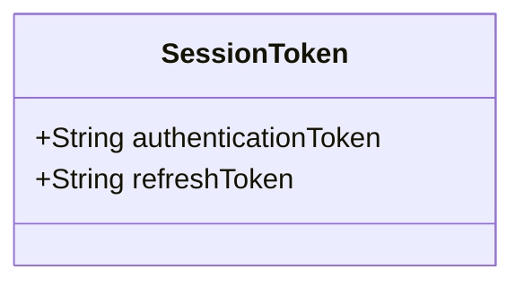
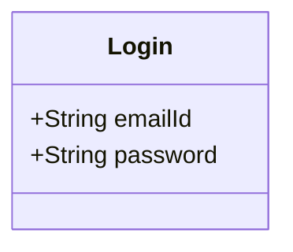
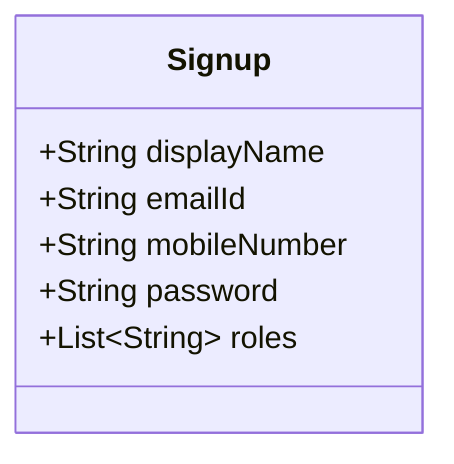
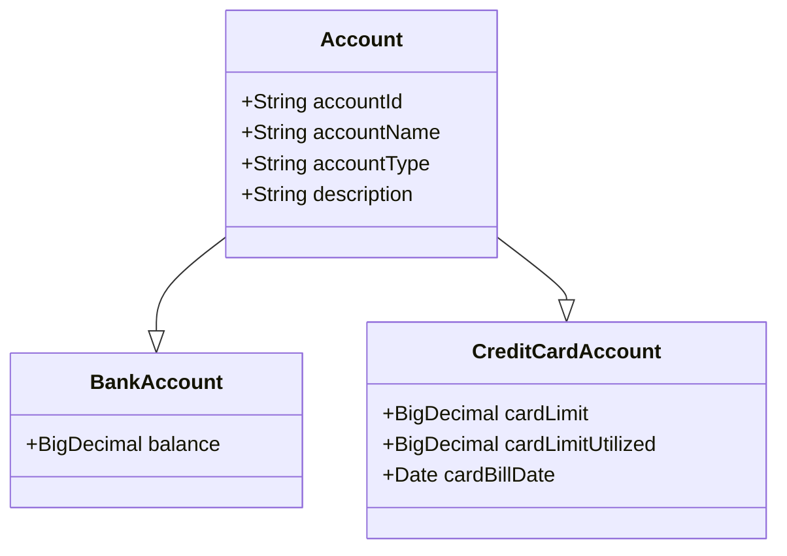
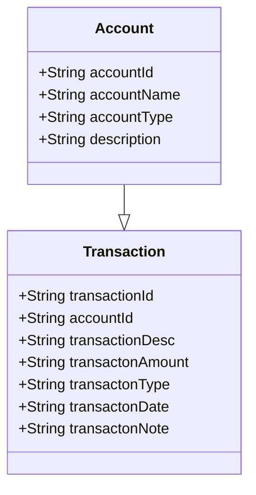
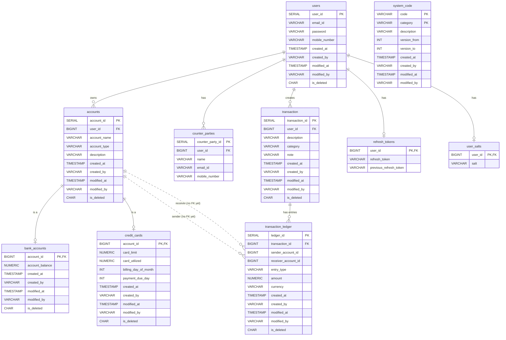

# Documentation

Purpose of this document is to record class diagrams, application's flow etc.

## Middlewares

### JWT Middleware

Every request has a Bearer token except , we verify the signature. If verification fails we return 401 Unauthenticated,

if verification is success we extract the claims from the token. We set the userId as a SystemContext and use it for all
api calls.

| Claims  | Description          |
|---------|----------------------|
| emailId | Email id of the user |
| userId  | id for the user      |


## Classes

### Session Token DTO



### Login DTO



### Signup DTO



### Account DTO



### Transaction DTOs



## Flow

### 1. Signup Flow

- **Input**: Accept [signup dto](#signup-dto)
- **Output**:
    - 200 OK User created successfully
    - 400 Bad request User already exist
- **Process**:

    ```mermaid
    sequenceDiagram
      Actor UserActor as Actor
      participant UserService
      participant Database
      
      UserActor ->> UserService: Sends signup dto
      UserService ->> Database: Check if the user in DB using email and mobile number
      alt User exist
          UserService ->> UserActor: Returns 400 User already exist
      end
      alt User not exist
          UserService ->> UserService: Rehash the password with user specific salt
          UserService ->> UserService: Hash the mobile number with application specific salt
          UserService ->> UserService: Add the role to create entities (like account, transaction etc.)
          UserService ->> Database: Save the entry in User's table
      end
  ```

### 2. Login Flow

- **Input**: Accept emailId and password
- **Output**: Session token i.e. combination of authentication token & refresh token
- **Process**:

    ```mermaid
    sequenceDiagram
        Actor UserActor as User
        participant JWTService
        participant Database
        participant UserService
        
        UserActor ->> UserService: Sends username & password
        UserService ->> Database: Find the user from DB
        alt User does not exist
            UserService ->> UserActor: Returns 404 User not found
        end
        alt User found
            Database ->> Database: Clear the password
            UserService ->> JWT: Send UserDetail to JWT
            JWT ->> JWT: Generate Authentication token
            JWT ->> JWT: Generate Refresh token
            JWT ->> UserService: Package tokens as a session token
            UserService ->> Database: Store refresh token in DB
            UserService ->> UserActor: Return session token
        end
    ```

### 3. Create Account

- **Input**: Accept [Account DTO](#account-dto)
- **Output**:
    - 200 OK Account created successfully
    - 400 Bad request Account already exist for the user
- **Process**:

    ```mermaid
        sequenceDiagram
            Actor UserActor as User
            participant J as JWT Middleware
            participant U as Users Service 
            participant A as Account Service 
  
            UserActor ->> J: User sends account dto
            J ->> J: Verify JWT token
            alt Token is invalid
                J ->> UserActor: 400 bad requests
            end
  
            J ->> J: Extract userObject
            J ->> J: Set user object in context
            J ->> A: Send account dto to account service
            A ->> A: Check if account Dto has id as null
            alt account id not null i.e. already exist for the user
                A ->> UserActor: Return 400 Account already exist for the user
            end
            alt account doesn't exist for the user
                A ->> A: Check if user has the role to create account
                alt user doesn't have the role for create account
                    A ->> UserActor: 401 not authorized
                end
                alt user have the role to create account
                    A ->> A: Save into the account table
                    A ->> UserActor: return account object
                end
            end
   
    ```

### 4. Fetch accounts for the user

- **Input**: Accept nothing as input
- **Output**:
    - 200 OK list of account linked with user
- **Process**:
    - Set the user id in context
    - Find all entry from account table where user id matches

      ```mermaid
          sequenceDiagram
              participant User
              participant J as JWT Middleware
              participant A as Account Service 
    
              User ->> J: User sends get request
              J ->> J: Extract user id and set context
              J ->> A: Process the request
              A ->> A: Find rows with user id in context 
              A ->> User: return accounts
     
      ```

## Table Structure

